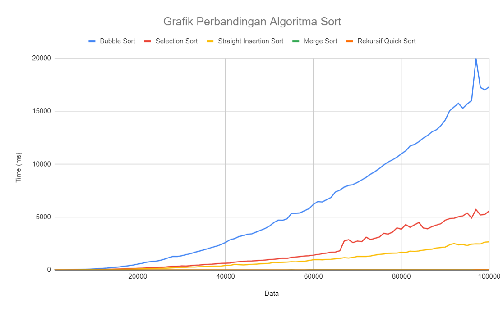

# Sorting Algorithms — C++ Benchmarks

A compact collection of C++ implementations that compares sorting algorithms through simple timing experiments. It is a **learning and benchmarking project**, not a formal microbenchmark suite.

## Implementations

| Algorithm | Source |
| --- | --- |
| Bubble sort | [`Bubble_Sort.cpp`](src/Bubble_Sort.cpp) |
| Selection sort | [`Selection_Sort.cpp`](src/Selection_Sort.cpp) |
| Insertion sort | [`Straight_Insertion_Sort.cpp`](src/Straight_Insertion_Sort.cpp) |
| Merge sort | [`Merge_Sort.cpp`](src/Merge_Sort.cpp) |
| Quick sort | [`Quick_Sort.cpp`](src/Quick_Sort.cpp) |

Each implementation is a standalone program. For example:

```bash
git clone https://github.com/rafli5131/compare-sort-algorithm.git
cd compare-sort-algorithm
g++ -std=c++17 -O2 src/Bubble_Sort.cpp -o bubble_sort
./bubble_sort
```

To try another algorithm, replace the source filename and output executable. On Windows, use an appropriate C++ compiler and run the generated `.exe`.

## Benchmark notes

The exercises generate input data and time algorithm execution using `std::chrono`. The sample output is displayed in the terminal; a [result chart](result.png) is included.



**Interpreting the results:** Runtime depends on input generation, input size, compiler optimization, hardware, and the experiment setup. The programs were written to explore algorithmic trade-offs; the graph should not be used as a platform-independent performance ranking. Some implementations may require further memory-management and measurement refinements.

## Technology

C++ standard library, `std::chrono`, and command-line compilation.

## Project scope

An educational exercise in data structures, algorithms, correctness checks, and basic performance analysis.
